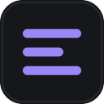
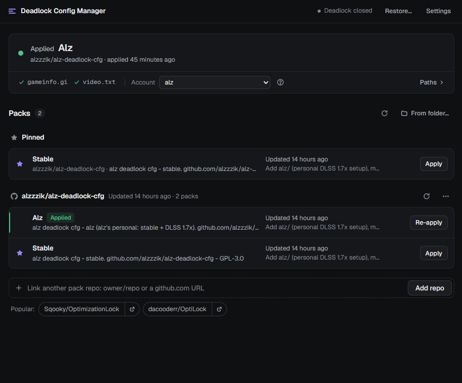
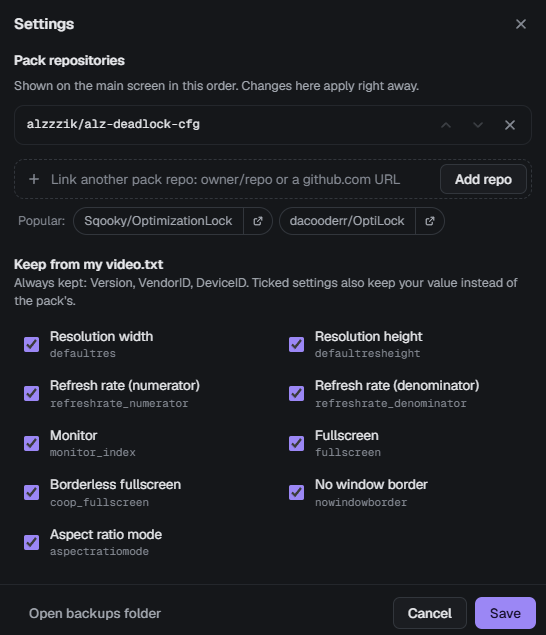

# Deadlock Config Manager

A Windows app for installing Deadlock FPS configs from GitHub.

  

 

Most Deadlock FPS configs come as a `gameinfo.gi` and a `video.txt` that you copy into the game by hand. You
have to keep your own GPU lines in `video.txt`, and redo it after game updates. This app handles that: pick a
config, see what it changes, apply it, and restore your old files if you want them back.

## Features

- Shows every setting a config changes before anything is written.
- Keeps your GPU IDs (`VendorID`, `DeviceID`) and display settings from your own `video.txt`.
- Backs up your files before every change. The first backup is kept as your original.
- Detects when a game update overwrites `gameinfo.gi` and lets you re-apply in one click.
- Works with any GitHub repo that has config folders. Each config shows when it was last updated.
- Works alongside Deadlock Mod Manager and Grimoire.

## Settings

Version, VendorID and DeviceID always come from your own `video.txt`. Resolution, refresh rate, monitor and
window mode are kept too by default; untick any of them to use the config's value instead.

You can also add, reorder and remove config repos here.

 

## Install

1. Download `Deadlock.Config.Manager_x.y.z_x64-setup.exe` from the
   [latest release](https://github.com/alzzzik/deadlock-config-manager/releases/latest).
2. Run it. It installs for your user only and doesn't need admin rights.
3. Windows may show "Windows protected your PC" because the app isn't code-signed. Click
   **More info**, then **Run anyway**. The installer is built from this repo by
   [GitHub Actions](https://github.com/alzzzik/deadlock-config-manager/actions); see
   [how to check a download](#how-do-i-know-the-installer-is-safe) and the
   [code signing policy](#code-signing-policy).

From v0.3.0 on, the app checks for new versions and offers to install them in one click.

To uninstall, go to Windows **Settings → Apps → Installed apps**, find Deadlock Config Manager and click
**Uninstall**. Your game files stay as they are; use **Restore original** first if you want them back.
Settings and backups in `%APPDATA%\DeadlockConfigManager\` are kept, so delete that folder too if you want
everything gone.

## Usage

1. Open the app. It finds your Deadlock install, your `video.txt` and your Steam account.
2. Click **Apply** on a config, check the list of changes, and confirm.
3. Start Deadlock. To go back, use **Restore…** and pick **Restore original**.

Close Deadlock before applying or restoring.

## Config repos

| Repo | Configs |
| --- | --- |
| [alzzzik/alz-deadlock-cfg](https://github.com/alzzzik/alz-deadlock-cfg) | Stable, Experimental (added by default) |
| [Sqooky/OptimizationLock](https://github.com/Sqooky/OptimizationLock) | Several community presets |
| [dacooderr/OptiLock](https://github.com/dacooderr/OptiLock) | Recommended, Potato, Ultra Potato |
| [7liv/compylock](https://github.com/7liv/compylock) | Competitive config |

Other repos can be added by pasting their GitHub link. If you make configs, see
[the expected folder layout](docs/DEVELOPMENT.md#for-pack-authors).

## FAQ

<b>Can I get banned for this?</b>

The app only edits `gameinfo.gi` and `video.txt`, the same files people edit by hand. I haven't seen any
reports of bans for config changes. Valve does block matchmaking if `gameinfo.gi` changes certain engine
sections, and some configs do that. If you can't queue, try another config or restore your original.

<b>How do I undo everything?</b>

Use **Restore…** and pick **Restore original**. That puts back the exact files from before your first apply.
Verifying the game files in Steam also restores Valve's default `gameinfo.gi`.

<b>A game update reset my config.</b>

Updates replace `gameinfo.gi`. Open the app and click **Re-apply**.

<b>Does it work with Deadlock Mod Manager or Grimoire?</b>

Yes. It keeps the search paths those tools add and doesn't make files read-only, so they can still edit
`gameinfo.gi`.

<b id="how-do-i-know-the-installer-is-safe">How do I know the installer is safe?</b>

Every release is built from this repo's source by GitHub Actions and lists a SHA-256 checksum in
`SHA256SUMS.txt`. In PowerShell, `Get-FileHash .\Deadlock.Config.Manager_*_x64-setup.exe` should print the same
value. Each installer also has a GitHub build attestation, which you can check with
`gh attestation verify <file> --repo alzzzik/deadlock-config-manager`. You can also upload it to
[VirusTotal](https://www.virustotal.com) before running it.

<b>What does it connect to?</b>

Only GitHub, to list and download configs and to check for app updates. See the
[privacy policy](#privacy-policy).

## Privacy policy

Deadlock Config Manager doesn't collect, store or send personal data, and has no telemetry, accounts or
background service.

To list and download configs, the app connects to GitHub (`github.com`, `api.github.com` and
`raw.githubusercontent.com`) for the config repos linked in the app, and checks this repo's latest release
for app updates. `alzzzik/alz-deadlock-cfg` is linked by
default and can be removed in Settings. These requests are covered by
[GitHub's privacy statement](https://docs.github.com/en/site-policy/privacy-policies/github-general-privacy-statement).
The app makes no other network connections.

Everything else stays on your PC: settings, backups and downloaded configs are stored in
`%APPDATA%\DeadlockConfigManager\`, and the only files it changes are Deadlock's `gameinfo.gi` and
`video.txt`, after showing you the changes.

## Code signing policy

Windows installers are built from the source in this repository by
[GitHub Actions](.github/workflows/release.yml) and published on the
[Releases](https://github.com/alzzzik/deadlock-config-manager/releases) page. Every release is approved by
hand before it's published.

Releases are not code-signed yet. Each release lists SHA-256 checksums and has a GitHub build attestation
instead. App updates are signed with a separate update key, and installed copies refuse updates that aren't.

Team roles:

- Committers and reviewers: [alzzzik](https://github.com/alzzzik)
- Approvers: [alzzzik](https://github.com/alzzzik)

## Contributing

Bug reports and repo suggestions go in
[Issues](https://github.com/alzzzik/deadlock-config-manager/issues). Build instructions and code layout are in
[docs/DEVELOPMENT.md](docs/DEVELOPMENT.md).

---

Not affiliated with Valve. Deadlock is a trademark of Valve Corporation. MIT licensed.
